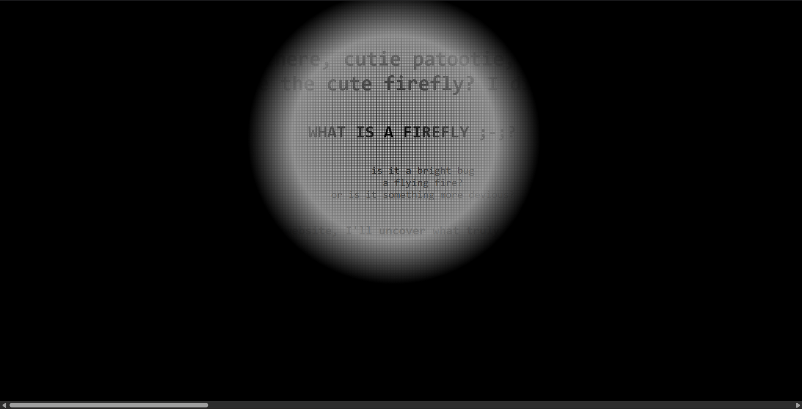
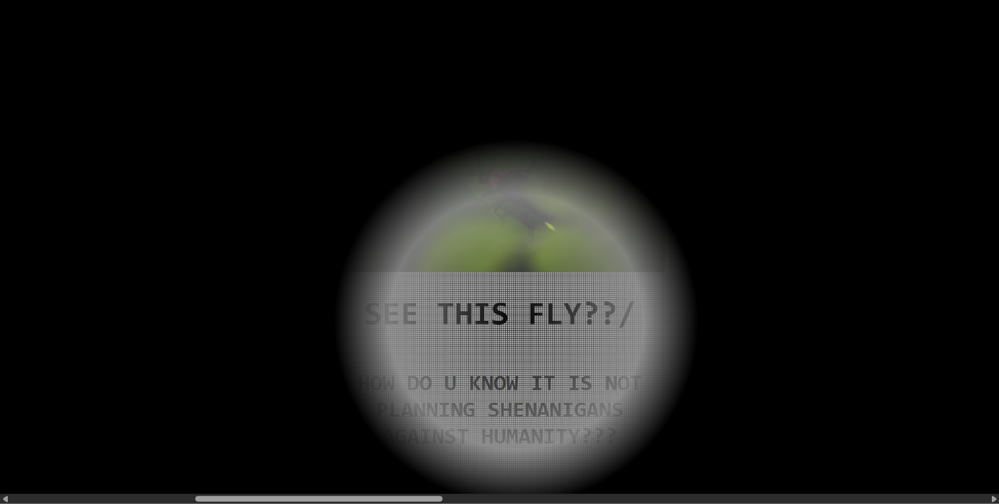
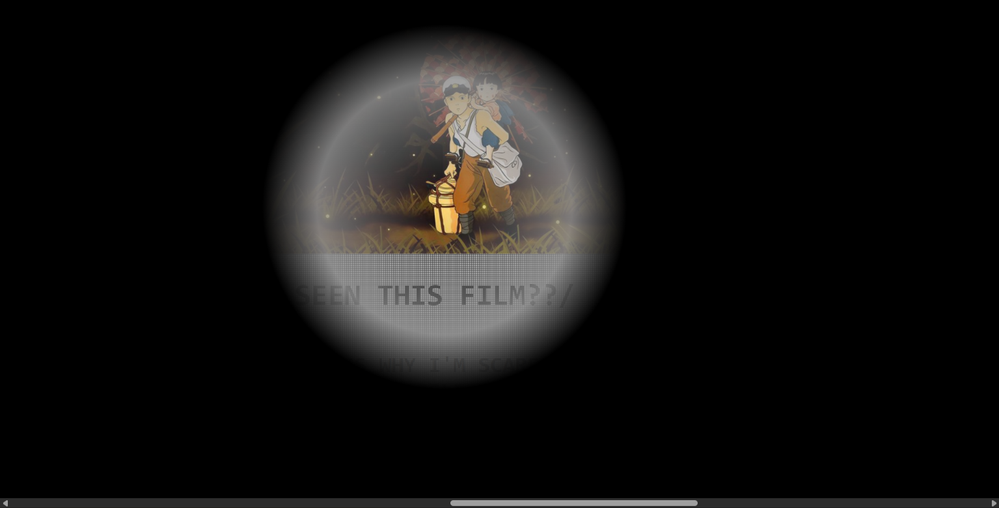

# Firefly
**coded by: Mukul**

I have coded this website to show you all the weirdness of fireflies, they're scary and not trustable. It's a dark theme website with a cool light effect.
# My demo link
[https://mukul-mittal-art.github.io/Firefly/](https://mukul-mittal-art.github.io/Firefly/)

# Tech stack
Program used: Visual Studio Code
Languages used: CSS, HTML, and Javascript.

# What does it do?
makes me happy. (jk)
It's a project that shows fireflies in an awkward state, it uses a custom cursor (hand drawn), and a cool dark effect around my cursor to help the user get immersed in my weird firefly conspiracy.

# How did i make it?
* I made a rough sketch on paper on how i want it to look
* I created all necessary files.
* Then, i used AI to get a 10 line code (I'm learning javascript)
* Then, i modified my website with more backgrounds, images, and content.
* I added final touches and finished my website!

# AI USAGE
a 10 line javascript code, NOTHING ELSE. I'm learning javascript but i really wanted to incorporate the dark effect in the website (couldn't do it without AI)

# Screenshots




# How to run the project locally
Clone and run this repository:
```bash
git clone https://github.com/mukul-mittal-art/Firefly.git